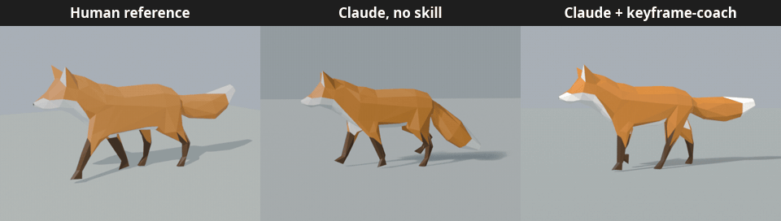
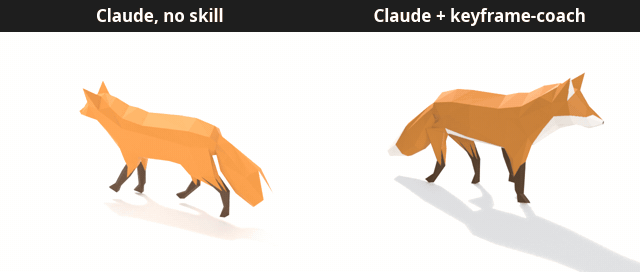

# Keyframe Coach

**A Claude Code skill that animates in Blender like a game animator would.**

Keyframe Coach teaches Claude the 12 principles of animation, adapted for games, and gives it a workflow to drive a live Blender through the official MCP for Blender connector: plan the timing, block the key poses, polish, audit, look at the result, and export to your engine.



<sub>Recreating a human-made walk cycle from a GIF. Same model (Claude Opus 5.5), same prompt, same fox.</sub>

---

## Contents

- [What it does](#what-it-does)
- [Results](#results)
- [Requirements](#requirements)
- [Install](#install)
- [Usage](#usage)
- [The audit script](#the-audit-script)
- [What's inside](#whats-inside)
- [Limitations](#limitations)
- [License](#license)

## What it does

- **Asks before it animates.** Export target (Unity, Unreal, Godot, Roblox) and style (realistic, cartoony, blocky, anime), plus loop vs one-shot and in-place vs root motion when it matters.
- **Animates like an animator.** Timing is planned in frames, then blocked pose-to-pose, then broken down onto arcs and polished with overlap, follow-through and easing.
- **Checks its own work.** A read-only audit script finds loop seams, foot sliding, quaternion flips, scale keys your engine will drop, and missing overlap.
- **Looks at the result** from the side and from the gameplay camera, instead of trusting the numbers.
- **Exports correctly** for Unity, Unreal, Godot and Roblox (scale, leaf bones, loops, root motion, bone-scale support).

## Results

Two tests on Claude Opus 5.5, each run once with and once without the skill, using the same low-poly fox model.

### Test 1: recreate a human-made animation from a GIF


| | No skill | With Keyframe Coach |
|---|---|---|
| Clip length | Guessed (24 frames) | Measured the reference (17 frames at 24 fps), made 16 |
| Tail carriage | Model's default, hanging down | Raised to match the reference |
| Framing and lighting | Close | Matched by comparing rendered frames with the reference |
| Paw contacts | Paws skate: they slide back at different speeds | Constant slide on all four paws, front paws roll and curl |
| Turns | 13 | 44 |

### Test 2: a walk cycle from scratch, rendered as a looping GIF



| | No skill | With Keyframe Coach |
|---|---|---|
| Staging | High camera, flat light, droopy tail | Three-quarter view, warm key light, cool backlight, real shadows |
| Legs | Small, subtle swings | Bigger swings, planted paws on a smooth arc, tail segments lagging |
| Turns | 12 | 18 |

**Honest take:** the skill clearly improves staging, reference matching and correctness (loops, contacts), at roughly 1.5–3× the turns. It doesn't match the human animator's stride and paw flick yet. These are single runs, not a benchmark.

## Requirements

- [Claude Code](https://claude.com/claude-code)
- [Blender](https://www.blender.org/) 4.2 or newer (tested on 5.2)
- The official **MCP for Blender** add-on and connector:
  ```bash
  uvx mcp-for-blender install-addon
  ```
  Then in Blender: Preferences → Add-ons → enable **Interface: MCP for Blender** → **Start MCP Server**, and add the `blender` MCP server to Claude Code.

## Install

It's a Claude Code plugin, so one command:

```bash
claude plugin install keyframe-coach --marketplace Guilherme-M-Mateus/keyframe-coach
```

That registers this repo as a marketplace and installs the plugin at user scope. Inside a session, the same in two steps: `/plugin marketplace add Guilherme-M-Mateus/keyframe-coach`, then `/plugin install keyframe-coach@keyframe-coach`.

The skill shows up as `/keyframe-coach`.

## Usage

Invoke it directly:

```text
/keyframe-coach Make a run cycle for the wolf rig, root motion, exported for Unreal.
```

Or just ask; Claude loads it when the request fits:

```text
Animate a sword slash for my knight, snappy, for Unity.
Polish this walk cycle: it looks stiff.
Why does my walk cycle slide in Unity?
```

## The audit script

`scripts/audit.py` is read-only and runs inside Blender (through the MCP connector, or headless):

```python
# <skill-dir> is the installed skill folder, which holds scripts/audit.py
exec(open("<skill-dir>/scripts/audit.py").read())
audit("Armature", engine="unity", loop=True)
```

```bash
blender -b walk.blend --python-expr "exec(open('skills/keyframe-coach/scripts/audit.py').read()); audit('Armature', loop=True)"
```

Example output:

```text
Audit 'rootAction' on root: frames 1-33 @ 24 fps, 87 curves
OVERLAP/TWINNING not checked: keys every 1-2 frames (baked or scripted)
FOOT BELOW FLOOR (b_LeftHand_011): 4.290 under the floor (armature origin) at frame 19; it clips through the ground (often a swing leg that doesn't fold enough)
FOOT BELOW FLOOR (b_RightHand_08): 4.297 under the floor (armature origin) at frame 3; it clips through the ground (often a swing leg that doesn't fold enough)
FEET checked: b_LeftFoot02_018, b_RightFoot02_022, b_LeftHand_011, b_RightHand_08 (in-place)
```

| Check | What it catches |
|---|---|
| Loop seam | Start and end values don't match, or hand-keyed end handles jump or stall the motion at the seam |
| Foot slide | The planted end of the foot (heel or toe) drifts while on the floor (root motion), or slides unevenly (in place) |
| Foot below floor | The foot's skinned mesh dips under the floor (the armature origin), e.g. a swing leg that doesn't fold |
| Quaternion flip | A limb swinging the long way round between keys |
| Scale keys | Squash and stretch your engine (Roblox, Unity Humanoid) will drop |
| No overlap / twinning | Every bone keyed on the same frames; left and right keyed alike (skipped when keys are every 1-2 frames) |
| Constraints | IK and other constraints that need baking on export (only when `engine` is set) |
| Interpolation | Leftover linear or constant keys |

Pass `feet=[...]` with the lowest bone of every leg (any number of legs); the foot checks are skipped without it, and a listed bone that never reaches the floor is reported. Treat its output as hints, not verdicts.

Self-test: `blender -b --factory-startup --python-exit-code 1 --python tests/test_audit.py`.

## What's inside

```text
keyframe-coach/
├── .claude-plugin/
│   ├── plugin.json       # Plugin manifest
│   └── marketplace.json  # Lets this repo install itself as a marketplace
├── skills/keyframe-coach/
│   ├── SKILL.md          # Workflow, questions, connector setup, audit usage
│   ├── references/
│   │   ├── principles.md # The 12 principles for games, style dials, frame budgets
│   │   ├── engines.md    # Export settings for Unity, Unreal, Godot, Roblox
│   │   └── legs.md       # Gaits for quadrupeds, insects and spiders
│   └── scripts/
│       └── audit.py      # Read-only animation audit
├── tests/
│   └── test_audit.py     # Headless self-test for the audit
├── .github/              # Social preview image
└── assets/               # README comparison GIFs
```

## Limitations

- Needs the official MCP for Blender connector and a running Blender with its server started.
- Roblox R15 and custom skinned rigs are untested; R6 rigs use the separate `roblox-blender-setup` skill.
- Motion quality still trails a human animator, especially stride length and secondary detail.
- Results above are single runs on one model.

## License

[MIT](LICENSE)
